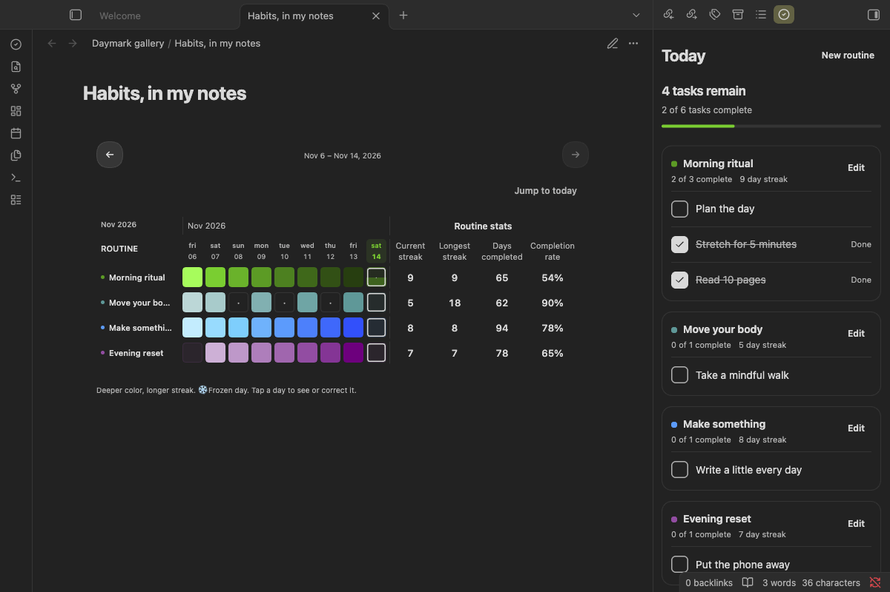
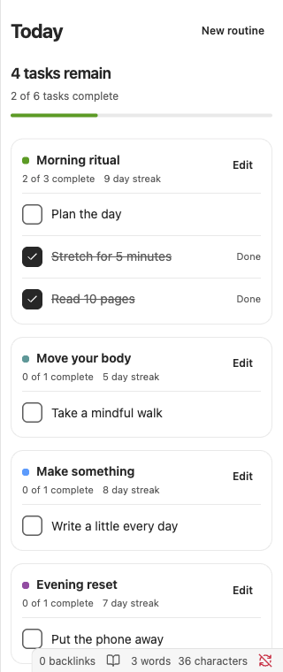
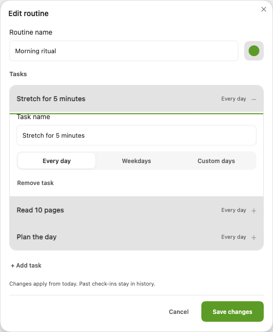
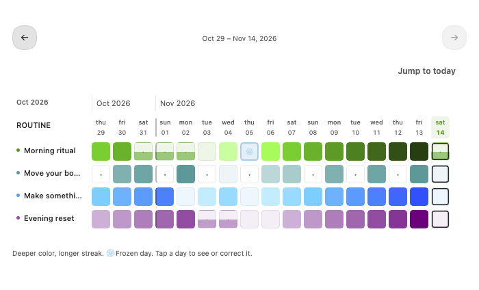
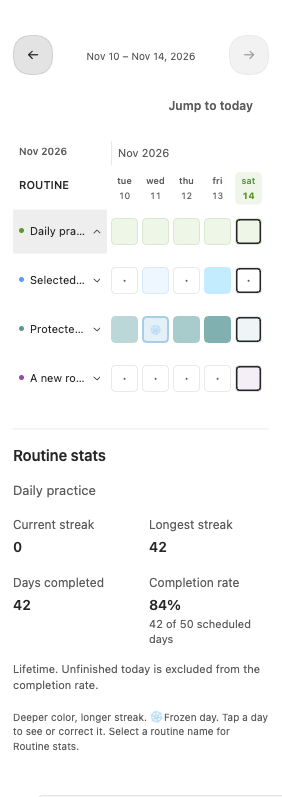
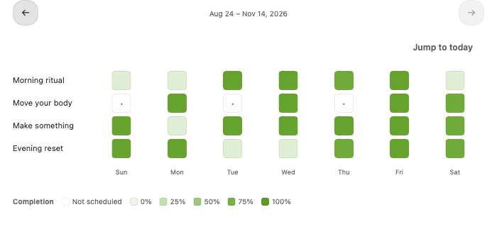
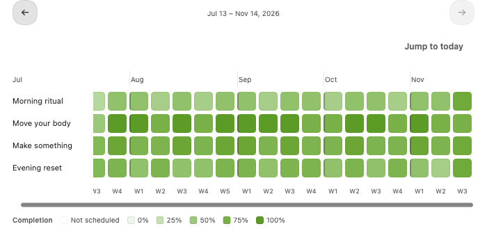
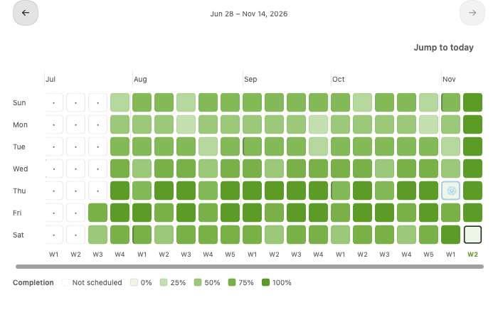
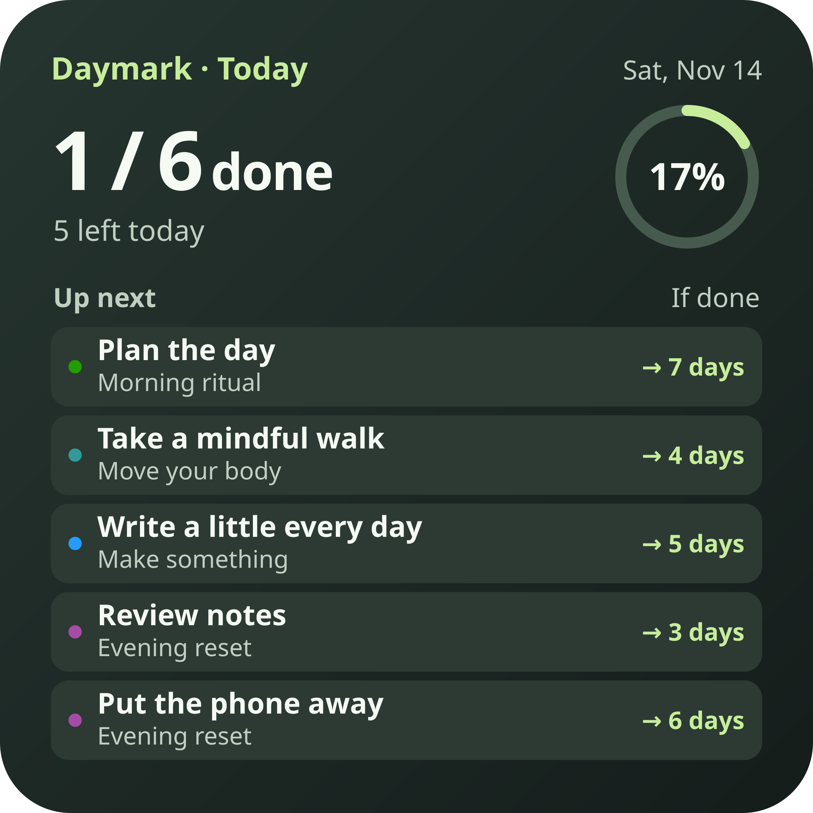

# Daymark Habits

Track habits and multi-task routines inside Obsidian. Check off today’s tasks in a sidebar, follow your streaks on a colorful board, and place completion heatmaps anywhere in your notes.



[View the desktop and mobile screenshot gallery](docs/images/gallery/README.md).

Created by **[niyoj](https://github.com/niyoj)**. Free, local, and open source. No account, subscription, telemetry, or network connection is required by the plugin.

## What you can do

- **Keep today manageable.** Group tasks into routines, see what remains, and check off a whole row. Completed tasks stay visible with a checkmark, strikethrough, and a Done label.
- **Give every task its own schedule.** Choose every day, weekdays, or custom days. A routine can combine tasks with different schedules.
- **Follow scheduled-day streaks.** Rest days do not break a streak. Correct a past check-in or protect a missed routine day with a manual freeze.
- **Build your own review note.** Embed one or several Daymark views alongside your headings, journal entries, and weekly reviews.
- **Keep history when routines change.** Renaming tasks or changing schedules applies from today; past check-ins retain their earlier definitions.
- **Export a widget snapshot.** Optionally write today’s tasks to `habit-widget.json` for a read-only Scriptable Home Screen companion.

## Install

Daymark Habits is being prepared for the Obsidian Community directory. Until the listing is approved, install it manually:

1. Download **`niyoj-daymark-0.2.2.zip`** from the [latest release](https://github.com/niyoj/daymark/releases/latest).
2. Extract the `niyoj-daymark` folder into your vault’s `.obsidian/plugins/` folder. It must contain `main.js`, `manifest.json`, and `styles.css` directly inside it.
3. Restart Obsidian or reload community plugins, then enable **Daymark Habits** under **Settings → Community plugins**.
4. Open the command palette and run **Daymark Habits: Open Today**.

Use the ZIP attached to the release, rather than GitHub’s **Source code** download. If your vault uses a custom configuration folder, use its `plugins/` folder instead of `.obsidian/plugins/`.

Requires Obsidian **1.8.0 or later**. The plugin uses mobile-compatible APIs. Desktop and phone-width layouts have been tested in Obsidian on macOS; physical iOS and Android testing is still outstanding.

## Create your first routine

1. Open Today from the command palette or the Daymark ribbon icon.
2. Select **New routine**, enter a name, and choose a color.
3. Name the first task and choose its schedule. For **Custom days**, select at least one weekday.
4. Use **Add a task** for additional steps, then **Save changes**.
5. Check tasks off in Today. Select a completed task again to undo its check-in.

Only one task editor is expanded at a time. Select a task’s collapsed row to edit its name or schedule. **Cancel** discards the draft.

| Today checklist | Routine editor |
| --- | --- |
|  |  |

## Put a view in any note

Add a fenced `habit-board` block in Reading view or Live Preview. Use `view:` to choose the view. Each block manages its own date range, scroll position, and selected cell.

### Habit Board

An Everyday-inspired board with routines in rows and dates in columns. Deeper color means a longer scheduled-day streak; a half-filled cell means some of that day’s tasks are complete. Month separators and weekday headers help orient you. The arrows browse history; **Jump to today** brings back the current date page.

````markdown
```habit-board
view: habit-board
```
````



**Habit Board is the default.** An empty `habit-board` block opens this view. At least seven date columns stay visible. In very narrow panes, routine names sit above their date cells. The available width determines how many additional dates fit. The board pages with the arrows and has no internal scrolling. Select a day to inspect tasks, correct a check-in, or use an eligible freeze.

**Routine stats** use each routine’s full history, independently of the dates you are browsing. Wide panes show four columns beside the grid, aligned with each routine. In narrow panes and on mobile, select a routine name (click, tap, Enter, or Space) to show its stats below the board.

| Label | Meaning |
| --- | --- |
| **Current streak** | Scheduled days completed in the ongoing streak. |
| **Longest streak** | The routine’s best streak across its full history. |
| **Days completed** | The total number of scheduled days on which all due tasks were completed. |
| **Completion rate** | Completed scheduled days divided by eligible scheduled days across the routine’s full history. |

Completion rate displays the percentage only, for example **84%**. Unscheduled days and future dates are excluded. An unfinished today joins the denominator only after the day ends; a completed today joins immediately. A frozen past day is scheduled but does not add a completion. With no eligible days, the rate is **—**. There is no Rate period selector.



### Weekday Patterns

One row per routine and one column per weekday. This helps answer questions like “Do I tend to miss this routine on Sundays?” Shading measures completed scheduled days for each weekday across the displayed range.

````markdown
```habit-board
view: weekday-patterns
```
````



**Weekday Patterns must now be selected explicitly.** If an older note relied on the empty block opening this heatmap, add `view: weekday-patterns` to keep that view.

### Weekly Consistency

One row per routine and one column per Monday–Sunday week. Shading measures the share of scheduled routine days completed in that week. Labels restart at W1 within each month band.

````markdown
```habit-board
view: weekly-consistency
```
````



### Calendar Overview

One square per date. Shading measures completed routines out of routines due that day. A snowflake marks a date with a freeze. Select a date for routine counts and **Edit check-ins** to open its task details.

````markdown
```habit-board
view: calendar-overview
```
````



The three analytics views share a green completion-rate scale. A routine day counts as complete when **all tasks due that day** are complete. Partial completion earns no completed-day credit; unscheduled days are excluded from the denominator and look different from scheduled days with zero completions. Freezes preserve streaks without adding completion credit.

Select a cell with a click, tap, **Enter**, or **Space** to see its exact count and date or period. **Escape** or **Done** closes the details and returns keyboard focus to the cell. Weekday Patterns uses a 12-week window; Calendar Overview and Weekly Consistency can reveal additional history to fill wider panes.

### Combine views and your own writing

````markdown
# Weekly review

What helped me show up this week?

```habit-board
view: weekly-consistency
```

## Daily history

A little context from my journal goes here.

```habit-board
view: habit-board
```
````

Blank lines and `#` comments are accepted inside a block. Use one `view:` option per block. An invalid value shows the available choices in that block. The earlier `habit-analytics` fence is supported as a compatibility alias.

The command **Daymark Habits: Insert habit board** inserts a block with `view: habit-board` already specified. It is available while editing a note.

## Streaks, corrections, and freezes

- A scheduled day is complete once every task due that day is checked off.
- Unscheduled days leave the streak unchanged. Today’s incomplete routine does not break yesterday’s streak while today is still in progress.
- Past check-ins can be corrected by opening a Habit Board cell. Future check-ins cannot be edited.
- You have **two manual freezes per calendar month, shared across all routines**. A freeze protects one missed routine day and uses the allowance for that missed date’s month.
- A freeze can only be applied to a past, scheduled, incomplete routine day. It does not mark tasks complete. Removing it returns that month’s allowance.
- Routine edits apply from today. Earlier names, schedules, check-ins, and freezes remain in history.

## JSON export and optional iPhone widget

Run **Daymark Habits: Export widget snapshot** to create or refresh **`habit-widget.json` at the vault root**. To refresh it automatically, enable **Settings → Daymark Habits → Export widget snapshot after changes**.

Automatic export refreshes after saved changes, on plugin startup, and when the running plugin detects a new local date. Manual export waits for preceding check-ins to finish saving. An export failure does not discard a successfully saved check-in.

The snapshot contains **today’s scheduled tasks**, split into `remaining` and `completed`, with task IDs, names, routine names, colors, a local date, and an update timestamp. It is **not a full-history backup**. The filename is `habit-widget.json`, not `habit.json`.

### Set up the Scriptable widget on iPhone

Use **Daymark Today**, the optional read-only Home Screen companion, to see your completed count, progress ring, and remaining tasks.



*Design mockup. The number of visible tasks depends on the widget size and device. The “If done” streak values are illustrative: the current Daymark export does not include `projectedStreak`, so this script shows **—** in that column.*

1. **Enable JSON export in Obsidian.** Turn on **Settings → Daymark Habits → Export widget snapshot after changes**. Run **Daymark Habits: Export widget snapshot** once and confirm that `habit-widget.json` appears at your vault root.
2. **Make the file available on your iPhone.** Locate the exported file in the iOS Files picker. If you export on another device, sync or copy the JSON to the iPhone first. A manual copy must be replaced whenever you want newer progress.
3. **Create the script.** Install and open [Scriptable](https://scriptable.app/). Tap **+**, name the script **Daymark Today**, and paste the complete contents of [Daymark-Today.js](companion/Daymark-Today.js). Use GitHub’s **Raw** view to copy the code, then save the script.
4. **Create the file bookmark.** In **Scriptable → Settings → File Bookmarks**, add a bookmark named exactly **Daymark Widget**. Select either `habit-widget.json` itself or the folder containing it. For a folder bookmark, `habit-widget.json` must be directly inside that folder. This gives the script access to the export. [Scriptable bookmark documentation](https://docs.scriptable.app/filemanager/#-bookmarkedpath).
5. **Run it once.** Open **Daymark Today** in Scriptable and tap **Run ▶**. Check that the preview shows today’s tasks and counts. The default in-app preview is large; change `previewSize` to `"small"` to preview the compact layout.
6. **Add it to the Home Screen.** Touch and hold an empty Home Screen area, choose **Edit → Add Widget**, select **Scriptable**, and add a **large** widget. Touch and hold the new widget, choose **Edit Widget**, and set **Script** to **Daymark Today**. Leave the parameter blank; this script uses the bookmark name configured in its code. You can also choose a small widget for a compact view. [Apple’s widget guide](https://support.apple.com/118610).

Check off a task in Obsidian, let the export update, then run the script again to confirm the counts change. The widget only reads the snapshot; check-ins stay in Obsidian. A previous-day export displays **Out of date**. A same-day export can still lag if Obsidian is closed or file synchronization has not finished.

The script requests a refresh in 15 minutes or at the next midnight, whichever comes first; [iOS controls the actual refresh timing](https://docs.scriptable.app/listwidget/#refreshafterdate). Physical iPhone bookmark access and Home Screen refresh remain unverified in this development environment.

For connection troubleshooting and the earlier companion, see [Scriptable companion setup](companion/README.md). For the snapshot schema and export verification, see [JSON export](docs/EXPORT.md).

## Data and privacy

Daymark stores routines, historical definitions, check-ins, and freezes in its local plugin `data.json`, normally at `.obsidian/plugins/niyoj-daymark/data.json`. It creates no account and sends no data over the network. Your notes are not rewritten when you change a view or routine.

The JSON export is optional and contains task names and completion information. The optional Scriptable companion reads the exported file through a file bookmark or a manually copied file; it does not modify check-ins.

Back up your vault **including its configuration folder** to preserve habit history. Device synchronization depends on your sync tool including the plugin’s data. Daymark does not reconcile simultaneous edits from multiple devices.

## Development and support

See [CONTRIBUTING.md](CONTRIBUTING.md) for building and testing, and [release preparation](docs/RELEASING.md) for the Community directory submission steps.

Found a bug or have a feature request? [Open an issue](https://github.com/niyoj/daymark/issues). Include the Daymark version, Obsidian version, device, and a minimal example.

Plugin screenshots show fictional demo records in the real plugin; the Scriptable widget image is a design mockup. Light and dark themes are supported in Obsidian. Phone-width verification uses desktop viewport emulation.

## License and acknowledgements

[BSD Zero Clause License](LICENSE). Copyright 2026 niyoj. The build configuration is adapted from the official Obsidian sample plugin and retains its Dynalist attribution.

The streak board and palette are inspired by [Everyday](https://everyday.app/). Daymark Habits is an independent project and is not affiliated with Everyday or Obsidian.
